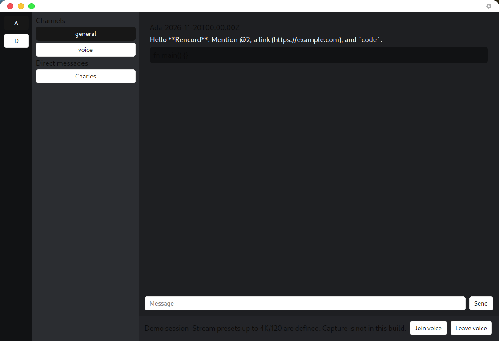
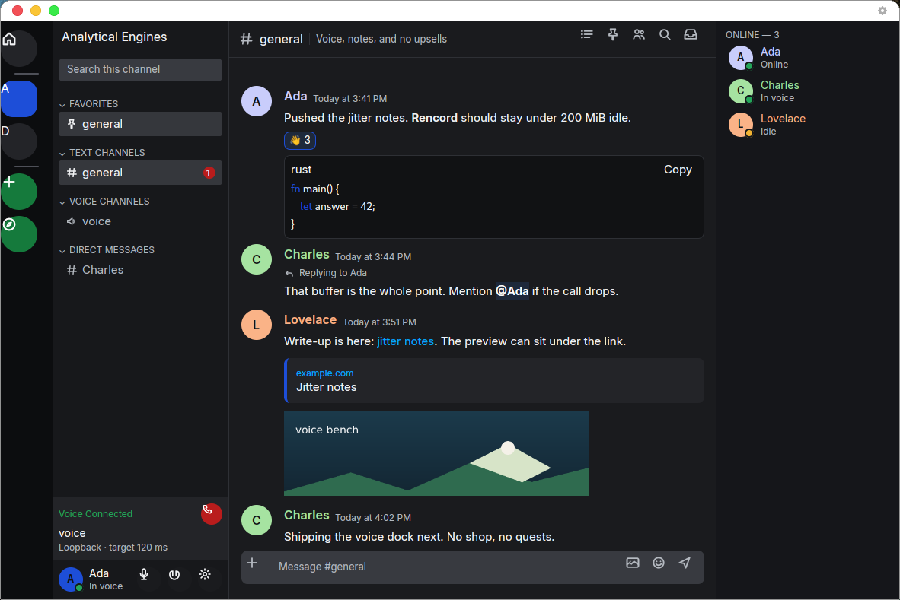
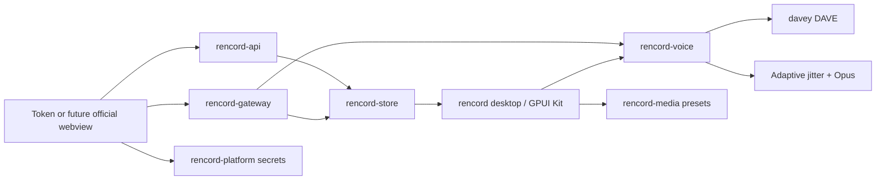

<p align="center">
  <strong>Rencord</strong>
</p>

<p align="center">
  A native Discord desktop client in Rust. The interface is GPUI. Voice uses an adaptive jitter buffer instead of a fixed 40&nbsp;ms window.
</p>

<p align="center">
  <a href="#build">Build</a>
  &nbsp;·&nbsp;
  <a href="#why-rencord">Why Rencord</a>
  &nbsp;·&nbsp;
  <a href="#feature-status">Feature status</a>
  &nbsp;·&nbsp;
  <a href="#architecture">Architecture</a>
  &nbsp;·&nbsp;
  <a href="#roadmap">Roadmap</a>
</p>

<p align="center">
  <a href="https://github.com/Rabellion/Rencord/actions/workflows/ci.yml"></a>
  <a href="LICENSE-MIT"></a>
  <a href="rust-toolchain.toml"></a>
  
</p>

---

> [!WARNING]
> **Unofficial client. Discord can terminate the account.**
> Rencord talks to Discord as your own user. Discord's Terms of Service forbid unauthorized clients and automating a normal user account outside the official OAuth2 and bot API. That can end the account. Nothing in this repository makes that safe or allowed. Read the [disclaimer](#disclaimer) before you paste a token. Use an account you can afford to lose. This project does not solve captchas, scrape, or send bulk messages.

---

## Why Rencord

Several native Rust clients already exist. Rencord is aimed at the gaps that show up in daily use, not at matching every feature on day one.

| | What you get today | What is still ahead |
| --- | --- | --- |
| **Voice cut-outs** | Adaptive jitter target from 40&nbsp;ms to 120&nbsp;ms, Opus PLC and in-band FEC, and a one-frame time-stretch instead of a hard skip. A loss simulation beats a fixed 40&nbsp;ms / 8-slot window at 1.5% and 5% loss. | Not measured on a live Discord call. Acoustic echo cancellation and noise suppression are not included. |
| **Interface** | One GPUI window (GPUI Kit 0.10). No egui, no Electron. | No themes, plugins, or virtualized million-row timeline. |
| **Streaming** | Quality presets up to 2160p120 are defined and are not hidden behind a Nitro check. The UI must not promise that Discord will accept them. | No capture, no encoder, no Go Live socket. An out-of-process worker is a typed protocol only. |
| **HDR** | Policy code tone-maps HDR to SDR unless both peers are Rencord and an SFU passthrough test has succeeded. That test has not been run. | No HDR capture. |

Serein, Concord, and Yapfast are further along as daily drivers. Rencord's Milestone 1 is the shell, the text path, and a voice engine whose jitter buffer is the part worth keeping.

## Screenshots

Captured from `rencord --demo` on Linux (X11, software GL). These are the real window, not mockups. Markdown is still drawn as text, and **Join voice** runs the in-memory loopback rather than a Discord UDP session.

| Guild, channels, DMs, and the timeline | After Join voice (loopback stats) |
| :---: | :---: |
|  |  |

## Feature status

Honest status for this repository. "Implemented" means the code path and tests exist. It does not mean a live Discord session was signed in from CI.

| Capability | Status | Notes |
| --- | --- | --- |
| Token login | Implemented | Paste a user token. Stored in a `0600` file under the data directory. |
| Official / QR / MFA login | Not in this build | Needs an ephemeral `https://discord.com/login` webview: WebView2 or WKWebView on Windows and macOS (`gpui-wry`, which does not cover Linux) and a separate GTK4 / WebKitGTK 6 window on Linux. No captcha solver. |
| Guild list, channel list, DM list | Implemented | Demo fixture plus REST bootstrap (`/users/@me`, guilds, channels, DMs). |
| Message history | Implemented | Bounded to 200 messages per channel in memory, with a SQLite copy. |
| Markdown | Implemented | Headings, quotes, fenced code, bold, italic, inline code, links, mentions, spoilers. Rendered as GPUI text. |
| Sending messages | Implemented locally; REST client tested against a mock | `POST /channels/{id}/messages` exists. The demo composer appends locally. A live send was not verified. |
| Gateway live updates | Implemented against a local socket | Identify, heartbeat, `READY`, `MESSAGE_CREATE`, and resume after the socket drops. Not verified against Discord's gateway. |
| Voice join, audio in and out | Partial | Local voice websocket + UDP stub covers IP discovery, select protocol, `aead_xchacha20_poly1305_rtpsize`, speaking, a DAVE prepare/ready exchange, resume, mute, deafen, and per-SSRC gain through the jitter buffer. cpal can open the default devices when they exist. The **Join voice** button still runs the in-memory loopback and then tries to open cpal. A live Discord voice server was not used. |
| DAVE (E2EE) | Implemented | `davey` 0.2. Two-member MLS encrypt/decrypt test. Opcode routing keeps the transport up when a welcome fails. |
| Adaptive jitter buffer | Implemented | See [Voice](#voice). |
| Screen share / camera / Go Live | Not implemented | Presets and the worker command enum only. |
| HDR | Policy only | Tone-map to SDR by default. |
| Notifications, keyring, tray, hotkeys | Stub | In-process notification sink. OS keyring is the intended next store; Milestone 1 uses the private file. |
| Threads, forums, uploads, reactions, search | Not implemented | |

## Build

Rust **1.100** is pinned in `rust-toolchain.toml`. You also need a C toolchain, CMake, `pkg-config`, and libopus.

### Linux

```sh
sudo apt-get install pkg-config cmake g++ \
  libopus-dev libasound2-dev libssl-dev libfontconfig1-dev \
  libxkbcommon-dev libxkbcommon-x11-dev libwayland-dev libvulkan-dev \
  libx11-dev libxcb1-dev libxcursor-dev libxi-dev libxrandr-dev

cargo test --workspace
cargo run -p rencord-desktop -- --demo
```

`--demo` opens the GPUI window on local fixture data. It does not contact Discord. Omit `--demo` to paste a token.

`RENCORD_DATA_DIR` overrides the data directory. The default is `$XDG_DATA_HOME/rencord` or `~/.local/share/rencord`.

### macOS

```sh
xcode-select --install
brew install opus pkg-config cmake
cargo test --workspace
cargo run -p rencord-desktop -- --demo
```

GPUI uses Metal on macOS. This environment did not compile or run the macOS target. The crates avoid Linux-only APIs except for the `0600` permission bit, which is cfg-gated.

### Windows

Install the Visual Studio C++ build tools, CMake, and a libopus the `audiopus` crate can find. Then:

```powershell
cargo test --workspace
cargo run -p rencord-desktop -- --demo
```

GPUI uses its DirectX / wgpu backend. This environment did not produce a Windows binary. CI runs on Linux only.

There is no installer, Flatpak, or Homebrew cask yet.

## Voice

Discord voice is 48 kHz Opus, usually 20 ms frames. A fixed two-frame buffer has nowhere to put a packet that arrives 60–90 ms late, so the reader skips ahead and the sentence drops out. Rencord's adaptive buffer:

- starts at an 80 ms target and moves between 40 ms and 120 ms
- estimates inter-arrival jitter (RFC 3550 style) and raises the target when a packet is late or concealed
- lowers the target only after a run of clean frames
- uses Opus in-band FEC when the next packet carries the missing frame, otherwise Opus PLC
- advances one frame when concealment is exhausted, instead of jumping to the newest packet
- drops a frame on purpose when the buffer is deeper than the target plus 40 ms (time-stretch compression)

`crates/rencord-voice` compares that buffer with `FixedWindow`, a baseline of the fixed 40 ms behavior, under a deterministic loss and delay trace. The adaptive buffer records fewer hard gaps at 1.5% and at 5% loss. That comparison is a simulation, not a recording of a Discord call.

DAVE v1 sits on top of the transport cipher. Media is encrypted with `davey` before `aead_xchacha20_poly1305_rtpsize`. Silence packets are left to davey's own passthrough rules. If an MLS welcome fails, the session reports it and leaves the UDP key in place.

## Architecture



```text
rencord/
├── apps/rencord-desktop/     GPUI shell and the session controller tests
└── crates/
    ├── rencord-model/        Snowflakes, users, guilds, channels, messages
    ├── rencord-protocol/     Gateway and voice websocket payloads
    ├── rencord-api/          REST client and per-route rate-limit buckets
    ├── rencord-gateway/      Identify, heartbeat, dispatch, zlib-stream
    ├── rencord-store/        In-memory session and SQLite drafts/history
    ├── rencord-markdown/     UI-free Discord markdown AST
    ├── rencord-voice/        RTP, transport AEAD, DAVE, Opus, jitter
    ├── rencord-media/        Stream presets, HDR policy, worker messages
    └── rencord-platform/     Data dir, token file, login requirements
```

The UI does not embed egui. Protocol crates do not depend on GPUI.

## Roadmap

1. **Threads, search, uploads, notifications.** Click-to-focus toasts and the OS keyring behind the existing `SecretStore` trait.
2. **Live voice on Linux, macOS, and Windows.** Finish UDP discovery against a real voice server, cpal capture and playback on the same session, and DAVE rekey without dropping the call.
3. **Go Live that stays up.** Per-OS capture (Windows Graphics Capture, ScreenCaptureKit, PipeWire portal), H.264 encode with a software fallback, and an out-of-process stream worker so a capture failure does not kill the call. Quality controls go up to 2160p and 120 fps with no Nitro checkbox. The UI will show Discord's documented caps (720p30 without Nitro, 4K60 with Nitro) and require an explicit acknowledgement before requesting more. Viewers on the official client may be transcoded or rejected. 120 fps is only offered when the local display reports that refresh.
4. **HDR between Rencord users.** Capture HDR where the OS allows it, tone-map to BT.709 8-bit for everyone else, and try a 10-bit path only after a measured SFU test. Mixed audiences stay SDR.
5. **Polish.** Multi-account, IME, accessibility, themes. Plugins only after chat and media are boring.

## FAQ

**Where do I get a token?**  
From your own client, on an account you control. Rencord will not read another app's storage for you. Official login is the plan described above; it is not built.

**Does Join voice put me in a Discord channel?**  
In this milestone the button runs the in-process loopback so you can see jitter stats without a call. The voice state machine and DAVE session are in `rencord-voice` and covered by tests. Wiring them to a live voice server is the next voice task.

**Will 4K / 120 work without Nitro?**  
The preset list is not gated. Discord's service is. Treat higher settings as a request, not a grant.

**Is the SQLite file encrypted?**  
No. The token file is mode `0600` on Unix. Logout should delete it; the menu for that is not in the window yet (`FileSecretStore::clear_token` is the API).

## Contributing

Issues and pull requests are welcome. Please:

- Keep the license `MIT OR Apache-2.0`. Do not add GPL dependencies.
- Do not copy Yapfast or Oxidecord source. Read them if you want; write new code.
- Keep GPUI as the only UI toolkit.
- Add a test for protocol or voice changes. `cargo test --workspace` and `cargo clippy --workspace --all-targets -- -D warnings` should pass.
- Do not add captcha solving, mass DMs, invite raids, or other automation.

## Acknowledgements

- [Serein](https://github.com/ViceVerse-cz/Serein) for the public crate layout and for documenting the fixed jitter window in issue 1033. Rencord does not include Serein's code.
- [davey](https://github.com/Snazzah/davey) by Snazzah, for the DAVE implementation.
- [GPUI Kit](https://github.com/longbridge/gpui-kit) and [GPUI](https://github.com/zed-industries/zed) from Zed.
- [libopus](https://opus-codec.org/) for the codec, PLC, and FEC.

## Disclaimer

Rencord is not Discord. It is not endorsed by Discord. Using it can violate the [Discord Terms of Service](https://discord.com/terms/) and the [self-bot policy](https://support.discord.com/hc/en-us/articles/115002192352-Automated-User-Accounts-Self-Bots), and Discord may suspend or terminate the account. Streaming above the official quality caps adds further policy risk. You are responsible for how you use this software.

## License

Rencord is dual-licensed under either of

- the MIT License ([LICENSE-MIT](LICENSE-MIT))
- the Apache License, Version 2.0 ([LICENSE-APACHE](LICENSE-APACHE))

at your option. Third-party licenses are listed in [THIRD_PARTY_NOTICES.md](THIRD_PARTY_NOTICES.md).
