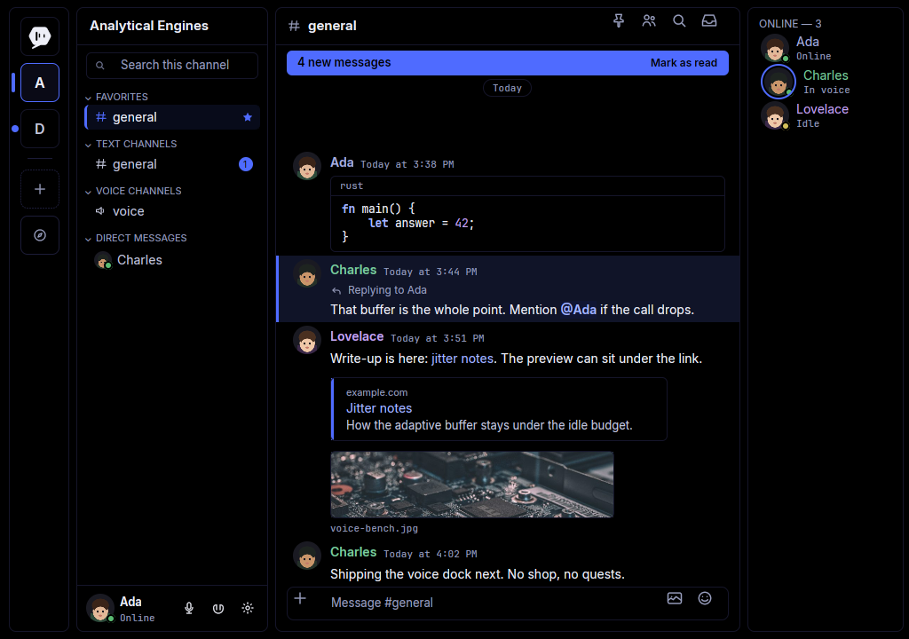
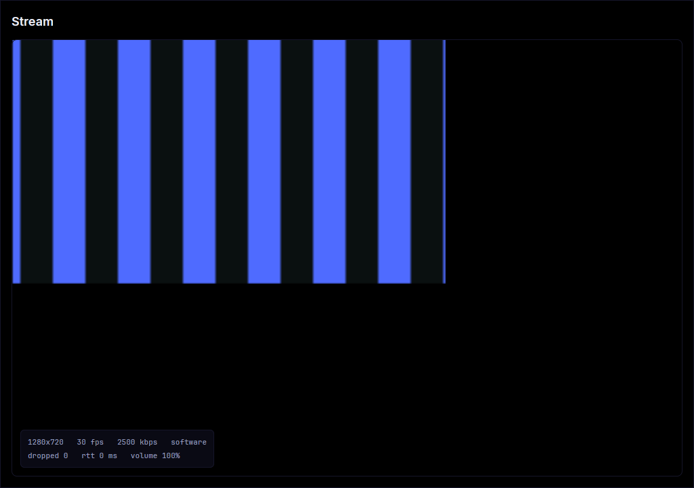
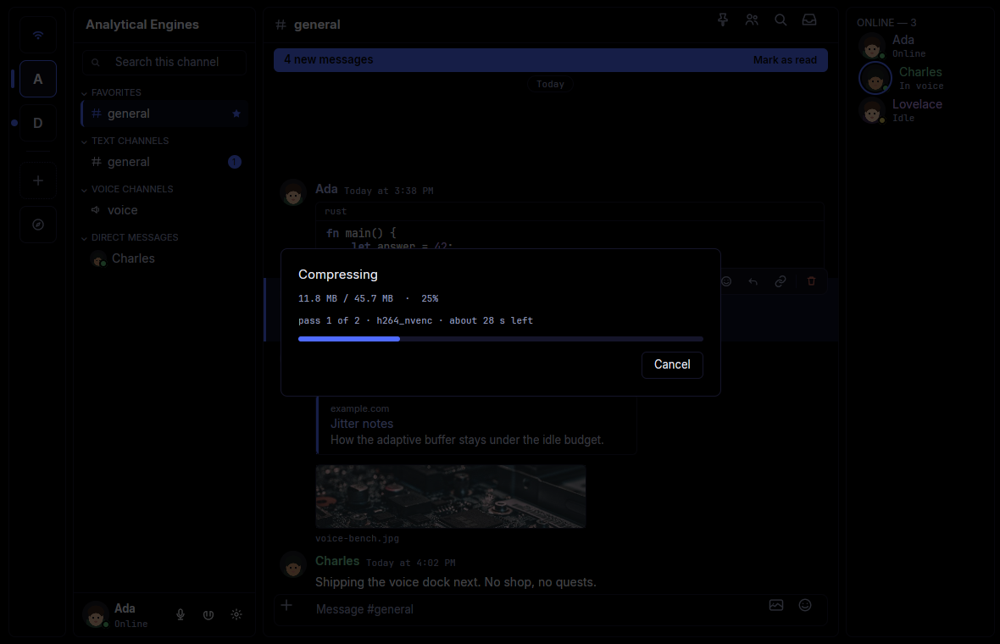
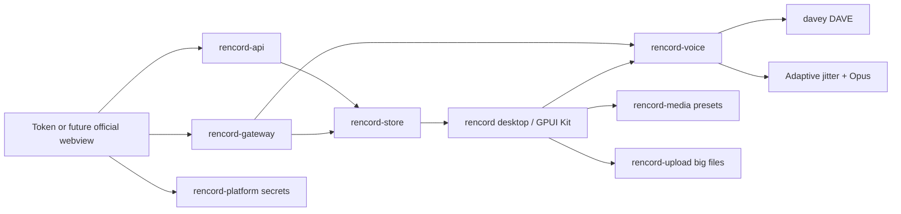

<p align="center"></p>

<p align="center">
  A native Discord desktop client in Rust. The interface is GPUI. Voice uses an adaptive jitter buffer instead of a fixed 40&nbsp;ms window.
</p>

<p align="center">
  <a href="#build">Build</a>
  &nbsp;·&nbsp;
  <a href="#why-rencord">Why Rencord</a>
  &nbsp;·&nbsp;
  <a href="#feature-status">Feature status</a>
  &nbsp;·&nbsp;
  <a href="#keyboard-and-settings">Keyboard</a>
  &nbsp;·&nbsp;
  <a href="#measured-on-this-machine">Measurements</a>
  &nbsp;·&nbsp;
  <a href="#architecture">Architecture</a>
  &nbsp;·&nbsp;
  <a href="#roadmap">Roadmap</a>
</p>

<p align="center">
  <a href="https://github.com/Rabellion/Rencord/actions/workflows/ci.yml"></a>
  <a href="LICENSE-MIT"></a>
  <a href="rust-toolchain.toml"></a>
  
</p>

<p align="center">
  Waver is the wordmark above. Hexwave is the app icon. Both live in <a href="assets/brand/README.md">assets/brand</a>.
</p>

---

> [!WARNING]
> **Unofficial client. Discord can terminate the account.**
> Rencord talks to Discord as your own user. Discord's Terms of Service forbid unauthorized clients and automating a normal user account outside the official OAuth2 and bot API. That can end the account. Nothing in this repository makes that safe or allowed. Read the [disclaimer](#disclaimer) before you paste a token. Use an account you can afford to lose. This project does not solve captchas, scrape, or send bulk messages.

---

## Why Rencord

Several native Rust clients already exist. Rencord is aimed at the gaps that show up in daily use, not at matching every feature on day one.

| | What you get today | What is still ahead |
| --- | --- | --- |
| **Voice cut-outs** | Adaptive jitter target from 40&nbsp;ms to 120&nbsp;ms, Opus PLC and in-band FEC, and a one-frame time-stretch instead of a hard skip. A loss simulation beats a fixed 40&nbsp;ms / 8-slot window at 1.5% and 5% loss. | Not measured on a live Discord call. Acoustic echo cancellation and noise suppression are not included. |
| **Interface** | GPUI Kit 0.10. Direction A layout. The default theme is Onyx Ink: a true-black canvas, `#15152A` hairlines, a `#4F6BFF` accent with black ink on the banner, Inter for the UI, and JetBrains Mono for timestamps and status. Themes and custom themes are free. The same four columns sit edge to edge and reflow for 16:9, 16:10, 21:9, 32:9, portrait, and small windows. Ctrl/Cmd+K, density, and type size are in settings. No Nitro surface. | Not a screen-reader pass. Plugins are still out. Layouts B and C remain behind `--layout`. |
| **Streaming** | In progress. Preview capture, the out-of-process worker, software encode, RTP, DAVE video wrap, and the Onyx picker/viewer/PiP are in the tree. VA-API and oneVPL are opened with `dlopen` when a device exists. A wide window shows the viewer only while a stream is open. | No GPU session on the CI machine, so hardware encode does not emit frames. The portal consent dialog, Windows Graphics Capture, and ScreenCaptureKit are not producing frames here. x264 is GPL and is not loaded. Discord may still reject a preset. |
| **HDR** | `rencord-hdr` tone-maps with BT.2390, Hable, or ACES, writes HDR10 SEI/OBU metadata, and classifies DXGI, ScreenCaptureKit, Wayland, PipeWire, and EDID descriptors. Settings can opt in. The Go Live worker still tone-maps before encode. A 10-bit Discord track needs every viewer to advertise Rencord HDR and a caller to set the SFU flag. That flag is not set. | No NVENC/AMF/QSV/VideoToolbox/VA-API encode session that emits frames, no HEVC/AV1 decoder, no test against Discord's servers. |

Serein, Concord, and Yapfast are further along as daily drivers. Milestone 1 is the shell and the text path. Milestone 2 adds a voice websocket and UDP session, tested against a local stub, with mute, deafen, and gain. Milestone 3 is the quieter window described in [docs/design/UX.md](docs/design/UX.md). None of this has been signed into a real Discord voice server.

## Screenshots

Captured from `rencord --demo --voice` on Linux (X11, software GL). The default theme is Onyx Ink. Every surface is `#000000`, meeting at a 1 px `#15152A` hairline. The accent is `#4F6BFF`, and the new-messages banner uses black text on that blue. Links and mentions use `#A8B8FF`. The UI face is Inter. Timestamps, the date pill, member and dock status, and the voice readout are JetBrains Mono. Avatars in the demo are illustrated. The window uses server decorations, so the theme fills the client area with no transparent margin. Settings stays in the user dock. `--theme dark` is the Discord-style dark palette, `--theme crisp` is the earlier dark palette, and `--theme amoled` is pure black. Preset captures are in [docs/design/themes/](docs/design/themes/). `--density compact` tightens the channel rows. **Join voice** runs the in-memory loopback and then tries to open the default cpal devices. It does not open a Discord UDP session. The millisecond figure in the voice card is the loopback target, not a fixed mock value.

| Onyx Ink | Voice |
| :---: | :---: |
|  |  |

| Compact | Hover |
| :---: | :---: |
|  |  |

Go Live, from `rencord --demo --golive picker|viewer|pip`. The pictures are preview frames. The stats line is the safe 720p30 preset on the software encoder.

| Source picker | Viewer |
| :---: | :---: |
|  |  |

Picture in picture: [docs/design/onyx/golive-pip.png](docs/design/onyx/golive-pip.png).

| Over the cap | Progress |
| :---: | :---: |
|  |  |

Upload in progress: [docs/design/onyx/big-file-upload.png](docs/design/onyx/big-file-upload.png). A failed upload, with Retry: [docs/design/onyx/big-file-error.png](docs/design/onyx/big-file-error.png).

## Feature status

Honest status for this repository. "Implemented" means the code path and tests exist. It does not mean a live Discord session was signed in from CI.

| Capability | Status | Notes |
| --- | --- | --- |
| Token login | Implemented | Paste a user token. Stored in a `0600` file under the data directory. |
| Official / QR / MFA login | Not in this build | Needs an ephemeral `https://discord.com/login` webview: WebView2 or WKWebView on Windows and macOS (`gpui-wry`, which does not cover Linux) and a separate GTK4 / WebKitGTK 6 window on Linux. No captcha solver. |
| Guild list, channel list, DM list | Implemented | Demo fixture plus REST bootstrap (`/users/@me`, guilds, channels, DMs). |
| Message history | Implemented | Bounded to 4000 messages per channel in memory, with a SQLite copy. The timeline is a variable-height virtual list. |
| Markdown | Implemented | Headings, quotes, fenced code, bold, italic, inline code, links, mentions, spoilers. A fenced block keeps its lines, a monospace face, a background, and a Copy button. |
| Sending messages | Implemented locally; REST client tested against a mock | `POST /channels/{id}/messages` exists. The demo composer appends locally. A live send was not verified. |
| Gateway live updates | Implemented against a local socket | Identify, heartbeat, `READY`, `MESSAGE_CREATE`. After the socket drops, the client reconnects and sends Resume with the saved session id and sequence. Not verified against Discord's gateway. |
| Voice join, audio in and out | Partial | `LiveCall` speaks the voice gateway and UDP against a local stub: identify or resume, IP discovery, select protocol, `aead_xchacha20_poly1305_rtpsize`, speaking, and a DAVE prepare / transition-ready exchange. Encrypted Opus is echoed through the adaptive jitter buffer. Mute, deafen, and per-SSRC gain are in that path. **Join voice** still runs the loopback, then opens the default cpal devices. Settings lists device names and remembers the choice; that name is not yet passed into cpal. A live Discord voice server was not used. |
| DAVE (E2EE) | Implemented | `davey` 0.2. Two-member MLS encrypt/decrypt test. Opcode routing keeps the transport up when a welcome fails. |
| Adaptive jitter buffer | Implemented | See [Voice](#voice). |
| Screen share / camera / Go Live | In progress | Worker, software encode, RTP, DAVE wrap, and `--golive` screens. VA-API and oneVPL are initialized when a device exists. This machine has no GPU session, so those encoders do not emit frames. PipeWire, Windows Graphics Capture, and ScreenCaptureKit do not produce frames yet. |
| HDR | Software path | Tone-map, 10-bit metadata, probes, and signalling. See [HDR](docs/design/HDR.md). The worker still tone-maps. Hardware encode and Discord passthrough are not linked. |
| Notifications, keyring, tray, hotkeys | Stub | In-process notification sink. OS keyring is the intended next store; Milestone 1 uses the private file. |
| Themes & custom themes, free | Implemented | Onyx Ink is the default. Light, Ash, Dark, Onyx, AMOLED, Midnight Blurple, Nord, Soft Contrast, and Crisp ship with the app. Custom colors, gradients, and theme files are not gated. The choice is stored per account and is not written back to Discord unless Follow Discord is on. See [docs/themes.md](docs/themes.md). |
| Responsive layout | Implemented | Breakpoints use width, height, and aspect ratio. 16:9 and 16:10 keep the four columns, including 1440×900, 1366×768, 1280×800, and 1280×720. 21:9 and 32:9 cap the message measure and leave the spare width as a gutter unless a stream, thread, or profile panel is open. Portrait keeps a narrow rail, a channel button, and drawers for channels and members. Column edges drag, double-click resets, and widths are stored per aspect and scale. `--window WxH` and `--scale` open a sized window. |
| Search | Implemented locally | `from:`, `in:`, `has:`, `before:`, and `after:` across cached channels, plus the guild search URL. A hit jumps to that message. Not verified against Discord's search service. |
| Reactions, reply, edit | Implemented locally; REST client tested against a mock | Optimistic update with rollback. Demo mode does not call Discord. |
| Big-file flow | Implemented | Discord still rejects a file over the account cap. The composer compares the size with the cap from `premium_type` and the guild boost tier, or uses `attachment_size_limit` when the API sends one. Over the cap, one sheet offers compress, an external link, or a split. Nothing is uploaded until you press the button, and a third-party host also needs the warning checked. |

## Build

Rust **1.100** is pinned in `rust-toolchain.toml`. You also need a C toolchain, CMake, `pkg-config`, and libopus.

### Linux

```sh
sudo apt-get install pkg-config cmake g++ \
  libopus-dev libasound2-dev libssl-dev libfontconfig1-dev \
  libxkbcommon-dev libxkbcommon-x11-dev libwayland-dev libvulkan-dev \
  libx11-dev libxcb1-dev libxcursor-dev libxi-dev libxrandr-dev

cargo test --workspace
cargo run -p rencord-desktop -- --demo
```

`--demo` opens the GPUI window on local fixture data. It does not contact Discord. The starting palette is Onyx Ink. `--theme` selects a preset (`onyx-ink`, `dark`, `ash`, `onyx`, `amoled`, `light`, `midnight-blurple`, `nord`, `soft-contrast`, `crisp`). `--theme-file` loads a TOML or JSON theme. `--open-settings` opens Appearance. `--layout a` is the default; `b` and `c` are the other presets. `--density compact` tightens the channel list. `--voice` starts the loopback call. `--golive picker`, `--golive viewer`, or `--golive pip` opens the Go Live screens. `--window 1440x900` sets the frame (logical pixels); `--scale 1.5` (or `150%`) sets `GPUI_X11_SCALE_FACTOR` before the window opens. `--screenshot path.png` grabs that frame and quits. `--bench` prints startup, RSS, frame gaps, and a resize sweep, then quits. `--bench stream` prints capture-to-encode time for the software encoder and quits. Omit `--demo` to paste a token.

```sh
cargo run -p rencord-desktop --bin rencord-measure -- --offline
```

## Keyboard and settings

| Action | Keys |
| --- | --- |
| Quick switcher | Ctrl+K or Cmd+K. Esc closes it. The header search icon opens it too. |
| Next / previous channel | Alt+Down / Alt+Up |
| Next / previous server | Ctrl+Alt+Down / Ctrl+Alt+Up |
| Settings | Ctrl+, or Cmd+, or the Settings button |

Settings > Appearance switches presets, syncs light and dark with the system, and edits a free custom theme. Density is compact 28 px rows, cozy 32 px, or spacious 36 px. Type size steps through 13–17 px. It lists cpal input and output names, shows the last loopback jitter line, and states that Go Live defaults to 720p30. The HDR row (Send, Receive, curve) is off by default. It configures the tone-map and the Rencord-to-Rencord plan. It does not start a capture. There is no Nitro row. Appearance stays on this machine unless Follow Discord is on, and even then Rencord only reads Discord's theme.

## Measured on this machine

Release build, `rencord --demo --bench`, Linux, X11, software GL, about 800 cached messages. A 120 Hz panel was not attached. The full write-up is [docs/design/UX.md](docs/design/UX.md).

| Budget | Target | Measured |
| --- | --- | --- |
| First frame | < 1000 ms | 117 ms release, 246 ms debug. Process start to the first bench frame on a warm page cache. |
| Idle RSS | < 200 MiB | 137 MiB release (`140228` KiB), 183 MiB debug. |
| Cached channel switch | < 50 ms | 669 ns average over 200 session switches. On-screen switches in the bench were 0–3 µs. |
| Frame gap | About one 60 Hz frame | p50 16.7 ms over 23 frames while the bench changed channel every frame. |
| Release binary | < 80 MB | 63 MB. The unstripped debug binary is 840 MB and is not the shipping build. |

HDR tone-map, same machine, `cargo bench -p rencord-hdr --bench throughput`, one thread, 1920×1080, release. The number includes the BT.2020 to BT.709 matrix. BT.2390 uses a 4096-entry PQ table; the f64 EETF is the accuracy reference, not the per-pixel path.

| Curve | 1080p frame | Throughput |
| --- | ---: | ---: |
| BT.2390 | 87.7 ms | 23.7 Mpix/s |
| Hable | 15.6 ms | 133 Mpix/s |
| ACES | 12.6 ms | 165 Mpix/s |

HDR10 SEI and the AV1 metadata OBUs together take 0.31 µs. BT.2390 is not a 60 fps 1080p grade on this core. Details and the samples the tests lock are in [docs/design/HDR.md](docs/design/HDR.md).

`RENCORD_DATA_DIR` overrides the data directory. The default is `$XDG_DATA_HOME/rencord` or `~/.local/share/rencord`.

### macOS

```sh
xcode-select --install
brew install opus pkg-config cmake
cargo test --workspace
cargo run -p rencord-desktop -- --demo
```

GPUI uses Metal on macOS. This environment did not compile or run the macOS target. The crates avoid Linux-only APIs except for the `0600` permission bit, which is cfg-gated.

### Windows

Install the Visual Studio C++ build tools, CMake, and a libopus the `audiopus` crate can find. Then:

```powershell
cargo test --workspace
cargo run -p rencord-desktop -- --demo
```

GPUI uses its DirectX / wgpu backend. This environment did not produce a Windows binary. CI runs on Linux only.

There is no installer, Flatpak, or Homebrew cask yet.

## Voice

Discord voice is 48 kHz Opus, usually 20 ms frames. A fixed two-frame buffer has nowhere to put a packet that arrives 60–90 ms late, so the reader skips ahead and the sentence drops out. Rencord's adaptive buffer:

- starts at an 80 ms target and moves between 40 ms and 120 ms
- estimates inter-arrival jitter (RFC 3550 style) and raises the target when a packet is late or concealed
- lowers the target only after a run of clean frames
- uses Opus in-band FEC when the next packet carries the missing frame, otherwise Opus PLC
- advances one frame when concealment is exhausted, instead of jumping to the newest packet
- drops a frame on purpose when the buffer is deeper than the target plus 40 ms (time-stretch compression)

`crates/rencord-voice` compares that buffer with `FixedWindow`, a baseline of the fixed 40 ms behavior, under a deterministic loss and delay trace. The adaptive buffer records fewer hard gaps at 1.5% and at 5% loss. That comparison is a simulation, not a recording of a Discord call.

Milestone 2 drives a real websocket and UDP socket, but the peer is a process on localhost:

- Hello, then Identify, or Resume (`op` 7) with `server_id`, `session_id`, `token`, and `seq_ack` after the socket is replaced
- Ready supplies the UDP address and SSRC; the client sends the 74-byte IP discovery packet and puts the answered address into Select Protocol
- Session Description installs the 32-byte `aead_xchacha20_poly1305_rtpsize` key; Speaking follows
- A DAVE prepare transition is answered with transition-ready. The MLS group itself is covered by the davey round-trip test, not by the stub
- Microphone frames are Opus-encoded, sealed, and written to UDP. Received packets are unsealed, jitter-buffered, then scaled by per-SSRC gain. Mute suppresses the packet. Deafen zeros playback
- The main gateway uses the same idea: on a clean close it reconnects and sends gateway Resume (`op` 6) when it still has a session id

None of that has been checked against `gateway.discord.gg` or a Discord voice server. The desktop button does not call `LiveCall` yet. It prints loopback stats and, when cpal can see devices, monitors the default microphone through the same jitter buffer.

DAVE v1 sits on top of the transport cipher. Media is encrypted with `davey` before `aead_xchacha20_poly1305_rtpsize`. Silence packets are left to davey's own passthrough rules. If an MLS welcome fails, the session reports it and leaves the UDP key in place.

## Architecture



```text
rencord/
├── apps/rencord-desktop/     GPUI shell and the session controller tests
└── crates/
    ├── rencord-model/        Snowflakes, users, guilds, channels, messages
    ├── rencord-protocol/     Gateway and voice websocket payloads
    ├── rencord-api/          REST client and per-route rate-limit buckets
    ├── rencord-gateway/      Identify, heartbeat, dispatch, zlib-stream
    ├── rencord-store/        In-memory session and SQLite drafts/history
    ├── rencord-markdown/     UI-free Discord markdown AST
    ├── rencord-voice/        RTP, transport AEAD, DAVE, Opus, jitter
    ├── rencord-media/        Stream presets, HDR policy, worker messages
    ├── rencord-hdr/          HDR probes, tone-map, 10-bit metadata, signalling
    ├── rencord-platform/     Data dir, token file, system appearance, login requirements
    ├── rencord-theme/        Semantic tokens, presets, custom theme files
    └── rencord-upload/       Cap check, compress, external hosts, split volumes
```

The UI does not embed egui. Protocol crates do not depend on GPUI.

## Roadmap

| Milestone | State | What landed |
| --- | --- | --- |
| 1. Shell and adaptive jitter | On `main` | GPUI window, token login, guild and DM lists, markdown history, local send, gateway identify against a local socket, jitter simulation. |
| 2. Live voice path | On `main` | Gateway resume, voice websocket + UDP discovery, transport cipher, speaking, DAVE control frames, mute, deafen, per-SSRC gain, default cpal devices. Local stubs only. |
| 3. UI | Chosen layout, ready to land | Direction A: Discord-shaped window with WCAG AA themes (Onyx, Dark, Ash, Light), grouped messages, hover actions, a flush user panel, and the six fixes (variable-height code blocks, REST reply/edit/delete/reactions, named audio devices, cross-channel search, AccessKit labels, refresh reporting). Screenshots: [docs/design/DIRECTIONS.md](docs/design/DIRECTIONS.md). |
| 3c. Responsive window | In the shell | The four-column shell holds 16:9, 16:10, 21:9, 32:9, 9:16, and small frames down to about 800×600. Reading width is capped on wide and 4K frames. Column splitters persist per aspect and DPI step. Window restore is clamped to the visible monitors. Captures: [docs/design/onyx/responsive](docs/design/onyx/responsive). |
| 3b. Other layouts | Behind `--layout` | `b` keyboard-first and `c` unified sidebar stay in the binary. They are not the default. |
| 4. Threads, search, uploads, notifications | Not started | OS keyring behind the existing `SecretStore` trait. |
| 5. Voice against Discord | Not started | Point `LiveCall` at a real voice server and keep DAVE rekeys without dropping the call. |
| 6. Go Live | In progress | Preview frames, `rencord-stream`, software encode, RTP, DAVE wrap, and `--golive` screens are on `main`. VA-API, oneVPL, NVENC, AMF, and VideoToolbox are probed by loading the system library and opening a session. They do not encode until a GPU session succeeds. Real Windows Graphics Capture, ScreenCaptureKit, and a PipeWire consumer are not producing frames yet. 120 fps is offered only when the display reports that refresh and the encoder sustains the budget. |
| 7. HDR between Rencord users (Milestone 5) | Software path | `rencord-hdr`: detection traits, BT.2390/Hable/ACES, HEVC Main10 and AV1 10-bit parameter blocks with HDR10 SEI/OBU, opt-in signalling, SDR fallback. `planned_pixel_path` is the hook the worker can call. `output_path` still tone-maps, so a running Go Live preview stays 8-bit. A Discord SFU test is not included. [docs/design/HDR.md](docs/design/HDR.md). |
| 8. Files over the attachment cap | Implemented | Discord enforces the per-file cap on the server. This client cannot lift it. The composer sheet plans against the API reference default of 20 MiB with no Nitro (the older account-caps table still says 10 MB; Nitro Basic 50 MiB; Nitro 1 GiB; boost level 2 is 50 MiB and level 3 is 100 MiB, server-only, taking the maximum). `attachment_size_limit` wins when the API sends it. Over the cap: compress (ffmpeg two-pass when a hardware encoder is on PATH, WebP or JPEG in-process, Opus for 48 kHz WAV), upload to Litterbox, Catbox, a 0x0.st-compatible host, or a presigned PUT / S3-compatible endpoint and post the link, or split into zip or 7z volumes under the cap. A Rencord message with the split note has a Reassemble control. Screenshots: [docs/design/onyx/big-file.png](docs/design/onyx/big-file.png), [docs/design/onyx/big-file-progress.png](docs/design/onyx/big-file-progress.png). |

The UI must not promise that Discord will accept a Go Live preset or a 10-bit stream. The capture worker publishes preview frames and tone-maps HDR to 8-bit. It does not send them to Discord. A 10-bit track stays off until a caller has proof the SFU forwarded HDR. There is no such proof in this repository.

## FAQ

**Where do I get a token?**  
From your own client, on an account you control. Rencord will not read another app's storage for you. Official login is the plan described above; it is not built.

**Does Join voice put me in a Discord channel?**  
No. The button runs the in-process loopback and then tries to open the default microphone and speaker. `LiveCall` can complete discovery, select protocol, transport encryption, speaking, and a voice-gateway resume, but only against the local stub in tests. It has not been pointed at a Discord voice server.

**Will 4K / 120 work without Nitro?**  
The preset list is not gated. The client asks for 720p30 until you pick something else. Discord's service can refuse a higher request, and sending more than the account is allowed can put the account at risk. On this machine there is no `/dev/dri` node. VA-API cannot open a GPU, oneVPL `MFXInit` returns -3, and NVENC is not installed. The software encoder does not sustain the frame budget: 1080p60 took 49742 µs (budget 16666), 1440p120 took 88548 µs (budget 8333), 2160p60 took 197401 µs (budget 16666), and 2160p120 took 197694 µs (budget 8333). A 320×180 preview averaged 582 µs to draw and 1340 µs to encode. x264 is installed and is not loaded, because it is GPL.

**Is the SQLite file encrypted?**  
No. The token file is mode `0600` on Unix. Logout should delete it; the menu for that is not in the window yet (`FileSecretStore::clear_token` is the API).

## Contributing

Issues and pull requests are welcome. Please:

- Keep the license `MIT OR Apache-2.0`. Do not add GPL dependencies.
- Do not copy Yapfast or Oxidecord source. Read them if you want; write new code.
- Keep GPUI as the only UI toolkit.
- Add a test for protocol or voice changes. `cargo test --workspace` and `cargo clippy --workspace --all-targets -- -D warnings` should pass.
- UI colors come from `rencord-theme` tokens. Do not put raw hex in `apps/rencord-desktop`. The hex lint test fails the build.
- Do not add captcha solving, mass DMs, invite raids, or other automation.

## Acknowledgements

- [Serein](https://github.com/ViceVerse-cz/Serein) for the public crate layout and for documenting the fixed jitter window in issue 1033. Rencord does not include Serein's code.
- [davey](https://github.com/Snazzah/davey) by Snazzah, for the DAVE implementation.
- [GPUI Kit](https://github.com/longbridge/gpui-kit) and [GPUI](https://github.com/zed-industries/zed) from Zed.
- [libopus](https://opus-codec.org/) for the codec, PLC, and FEC.

## Disclaimer

Rencord is not Discord. It is not endorsed by Discord. Using it can violate the [Discord Terms of Service](https://discord.com/terms/) and the [self-bot policy](https://support.discord.com/hc/en-us/articles/115002192352-Automated-User-Accounts-Self-Bots), and Discord may suspend or terminate the account. Streaming above the official quality caps adds further policy risk. You are responsible for how you use this software.

## License

Rencord is dual-licensed under either of

- the MIT License ([LICENSE-MIT](LICENSE-MIT))
- the Apache License, Version 2.0 ([LICENSE-APACHE](LICENSE-APACHE))

at your option. Third-party licenses are listed in [THIRD_PARTY_NOTICES.md](THIRD_PARTY_NOTICES.md).
